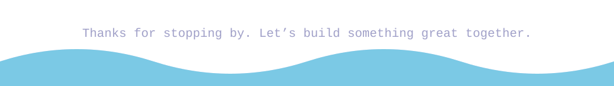

 

 

 

## 🎓 About Me

- 🏛️ **B.Tech in Computer Science & Engineering (Core)** at **VIT Vellore, Main Campus**
- 💻 Building across **embedded systems, Python, web and ML notebooks**
- 🏆 Hackathon regular who loves turning rough ideas into working prototypes
- 📚 Exploring new tech all the time, and **many more projects are on the way**
- 🤝 Open to collaborating. Reach me at **agarwalshivansh05@gmail.com**

## ⚡ Tech Arsenal

 

## 🚀 Featured Projects

A few highlights from my 10+ repositories, with new builds landing all the time.

<table>
<tr>
<td width="50%" valign="top">

### 🪸 [Coral_Hackathon](https://github.com/SA6196/Coral_Hackathon)
A hackathon build created and shipped against the clock. 
`JavaScript` · ⭐ 4

</td>
<td width="50%" valign="top">

### 🤖 [Rover_Embedded_System](https://github.com/SA6196/Rover_Embedded_System)
Embedded code that brings a rover to life. 
`C++` · Hardware meets software

</td>
</tr>
<tr>
<td width="50%" valign="top">

### 📡 [Sonar](https://github.com/SA6196/Sonar)
Sonar-style sensing explored in Python. 
`Python` · ⭐ 1 · 🍴 1

</td>
<td width="50%" valign="top">

### 💬 [communique_](https://github.com/ojasjog/communique_)
A communication-focused project built with a teammate. 
`Python` · ⭐ 4

</td>
</tr>
<tr>
<td width="50%" valign="top">

### 👥 [crowd-density-estimator](https://github.com/siddharthkalyavit2025/crownd-density-estimator)
Estimating crowd density inside a notebook. 
`Jupyter` · Collaboration

</td>
<td width="50%" valign="top">

### 🏁 [RMCS Codechef](https://github.com/SA6196/RMCS_Codecheif_By_Shivansh-Agarwal__)
A competitive coding solution. 
`Python` · ⭐ 1

</td>
</tr>
</table>

### 🔎 Many more projects to explore

 

## 🧭 Currently

<b>🔭 What I&#8217;m up to</b>

- 🛠️ Building across **embedded systems, Python and web**
- 🏆 Chasing the next **hackathon**
- 🎓 Going deep on **CSE core** subjects at VIT Vellore
- 🚀 Starting new projects faster than I finish my coffee ☕

<b>🎯 Fun facts</b>

- 🤖 I like projects where code touches the real world
- ⚡ I learn fastest by building and breaking things

 

